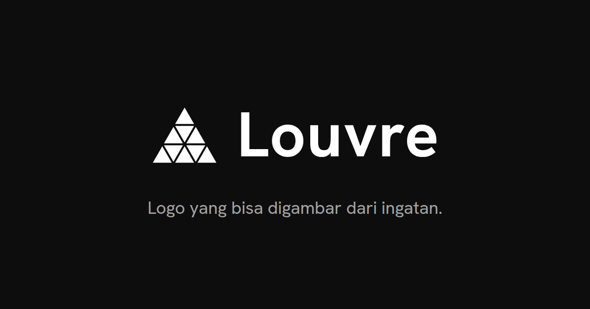

# Louvre — identitas visual



Piramida kaca dari sembilan segitiga. Repo ini berisi logo Louvre, panduan
pemakaiannya, dan situs brand guide di **https://logo.louvre.my.id/**.

## Isi

| Folder | Isi |
|---|---|
| `site/` | Situs statis yang disajikan apa adanya (ID di `/`, EN di `/en/`). |
| `site/assets/symbol/` | Simbol (tinta, putih), ikon aplikasi, favicon. |
| `site/assets/lockup/` | Lockup simbol + nama: dua nada, tinta, putih. SVG, PNG, JPG, WebP, PDF. |
| `site/assets/mockups/` | Contoh penerapan: kaos, mug, tote, kartu nama, dll. |
| `site/assets/download/` | Paket logo dan paket mockup (.zip). |
| `src/` | Script pembuat aset dan HTML, plus `Caddyfile`. |

## Logo

- **Simbol:** sembilan segitiga dalam tiga baris (1, 3, 5), dengan celah tipis di antaranya.
- **Nama:** selalu ditulis **Louvre**, L kapital, sisanya huruf kecil.
- **Font:** Hanken Grotesk 700 untuk nama, SIL OFL 1.1.
- **Warna:** tinta `#0D0D0D`, putih `#FFFFFF`, dan tiga abu (`#F4F4F4`, `#E5E7EB`, `#5D5D5D`). Tidak ada warna aksen.

Aturan ruang aman, ukuran minimum, dan hal yang perlu dihindari ada di situsnya.

## Membuat ulang aset

Butuh Python 3 dan Google Chrome (untuk render PNG/PDF).

```sh
python3 -m venv .venv && .venv/bin/pip install fonttools uharfbuzz pillow
.venv/bin/python src/lockup.py     # lockup SVG dari font
.venv/bin/python src/formats.py    # PNG, WebP, JPG, PDF lockup
.venv/bin/python src/mockups.py    # mockup dengan lockup terbaru
.venv/bin/python src/og.py         # gambar Open Graph
.venv/bin/python src/kits.py       # paket .zip
.venv/bin/python src/build.py      # HTML, thumbnail, sitemap
```

## Menjalankan lokal

```sh
docker run --rm -p 8088:80 \
  -v "$PWD/site:/srv:ro" \
  -v "$PWD/src/Caddyfile:/etc/caddy/Caddyfile:ro" \
  caddy:2-alpine
```

Lalu buka http://localhost:8088/.

## Lisensi

- **Kode** (`src/`, serta HTML/CSS/JS di `site/`): [MIT](LICENSE).
- **Logo dan aset merek**: hak cipta dilindungi, lihat [ASSETS-LICENSE.md](ASSETS-LICENSE.md).
- **Font Hanken Grotesk**: [SIL OFL 1.1](site/assets/font/OFL.txt).
